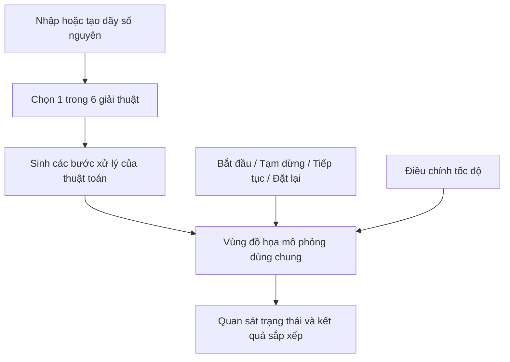

# 📊 SORTING ALGORITHM VISUALIZER

### MÔ PHỎNG HOẠT ĐỘNG CỦA MỘT SỐ GIẢI THUẬT SẮP XẾP TRÊN MÀN HÌNH ĐỒ HỌA

**Đồ án cơ sở ngành · Khoa Công nghệ Thông tin · Trường Đại học Nha Trang**

  
  
  
  

  
  
  

_Học giải thuật bằng cách **nhìn thấy từng bước xử lý** — từ so sánh, hoán đổi đến chia, trộn và phân hoạch._

---

## 🌟 Giới thiệu

Trong học phần **Cấu trúc dữ liệu và Giải thuật**, việc chỉ quan sát giả mã hoặc mã nguồn có thể khiến người học khó hình dung quá trình sắp xếp diễn ra như thế nào. Đề tài này hướng đến việc xây dựng một **ứng dụng đồ họa trên Windows**, giúp trực quan hóa các thao tác của sáu giải thuật sắp xếp thông dụng.

Thay vì hiển thị riêng kết quả cuối cùng, ứng dụng **được thiết kế để biểu diễn diễn biến từng bước**: các phần tử đang được so sánh, hoán đổi, dịch chuyển, phân hoạch, trộn hoặc đưa về đúng vị trí.

> **Ý tưởng giao diện:** Sáu lựa chọn thuật toán nằm ở **phía trên**; phía dưới là **một vùng mô phỏng dùng chung**, chỉ hiển thị thuật toán đang được chọn.

---

## 🎯 Mục tiêu đồ án

- Nghiên cứu nguyên lý, độ phức tạp thời gian, bộ nhớ phụ và tính ổn định của sáu giải thuật sắp xếp.
- Xây dựng ứng dụng bằng **C#**, trên nền tảng **.NET Windows Forms**.
- Mô phỏng thao tác xử lý đối với **dãy số nguyên theo thứ tự tăng dần**.
- Tạo giao diện trực quan, dễ quan sát, có khả năng điều khiển tiến trình mô phỏng.
- Kiểm tra tính chính xác của thuật toán với nhiều dạng dữ liệu đầu vào.

---

## 🧠 Sáu giải thuật được nghiên cứu

| Giải thuật         | Ý tưởng chính                                      |  Tốt nhất  | Trung bình |  Xấu nhất  | Bộ nhớ phụ | Ổn định |
| :----------------- | :------------------------------------------------- | :--------: | :--------: | :--------: | :--------: | :-----: |
| **Selection Sort** | Chọn phần tử nhỏ nhất đưa về đầu vùng chưa sắp xếp |   O(n²)    |   O(n²)    |   O(n²)    |    O(1)    |  Không  |
| **Bubble Sort**    | So sánh và đổi chỗ các phần tử kề nhau             |   O(n)¹    |   O(n²)    |   O(n²)    |    O(1)    |   Có    |
| **Insertion Sort** | Chèn phần tử vào đúng vị trí trong đoạn đã sắp xếp |    O(n)    |   O(n²)    |   O(n²)    |    O(1)    |   Có    |
| **Merge Sort**     | Chia dãy thành các phần nhỏ rồi trộn có thứ tự     | O(n log n) | O(n log n) | O(n log n) |    O(n)    |   Có    |
| **Quick Sort**     | Chọn pivot, phân hoạch và xử lý các dãy con        | O(n log n) | O(n log n) |   O(n²)    | O(log n)²  |  Không  |
| **Heap Sort**      | Xây dựng heap, đưa phần tử lớn nhất về cuối dãy    | O(n log n) | O(n log n) | O(n log n) |   O(1)³    |  Không  |

<b>🔎 Xem thao tác nổi bật của từng thuật toán</b>

| Thuật toán         | Nội dung dự kiến làm nổi bật khi mô phỏng                   |
| ------------------ | ----------------------------------------------------------- |
| **Selection Sort** | Vị trí đang xét, phần tử nhỏ nhất tạm thời, đoạn đã sắp xếp |
| **Bubble Sort**    | Hai phần tử đang so sánh, hoán đổi, đoạn cuối đã hoàn thành |
| **Insertion Sort** | Phần tử khóa (key), phần tử đang dịch chuyển, vị trí chèn   |
| **Merge Sort**     | Hai dãy con, các bước trộn, dãy kết quả cập nhật            |
| **Quick Sort**     | Pivot, vùng phân hoạch, phần tử được hoán đổi               |
| **Heap Sort**      | Gốc heap, vị trí hoán đổi, vùng đã sắp xếp                  |

---

## ✨ Các chức năng dự kiến

| Nhóm chức năng         | Mô tả                                                                                   |
| ---------------------- | --------------------------------------------------------------------------------------- |
| 🔢 **Dữ liệu đầu vào** | Nhập hoặc tạo dãy số nguyên để mô phỏng                                                 |
| 🧩 **Chọn thuật toán** | Lựa chọn 1 trong 6 thuật toán ngay trên cùng giao diện                                  |
| ▶️ **Điều khiển**      | Bắt đầu, tạm dừng, tiếp tục và đặt lại quá trình mô phỏng                               |
| 🎚️ **Tốc độ**          | Điều chỉnh tốc độ chuyển đổi giữa các bước                                              |
| 🎨 **Trực quan hóa**   | Hiển thị phần tử bằng cột hoặc ô; tô nổi bật các trạng thái xử lý                       |
| 📈 **Theo dõi**        | Hiển thị kết quả sắp xếp và các thống kê phù hợp như số lần so sánh, hoán đổi/di chuyển |

> **Lưu ý về tiến độ:** Đây là các **yêu cầu và chức năng mục tiêu** được nêu trong báo cáo đồ án, **không phải cam kết rằng tất cả đã được lập trình hoàn chỉnh**.

---

## 🏗️ Thiết kế hoạt động

Theo phương án thiết kế, chương trình được tổ chức thành **ba nhóm thành phần chính**:

1. **Quản lý dữ liệu đầu vào** — tiếp nhận hoặc tạo mảng số nguyên.
2. **Xử lý giải thuật** — thực hiện sáu giải thuật và tạo chuỗi bước mô phỏng tương ứng.
3. **Giao diện & hiển thị** — chọn thuật toán, điều khiển quá trình và vẽ trạng thái trên vùng hiển thị chung.

Dữ liệu trong phạm vi cơ bản được nhập hoặc tạo trực tiếp trong ứng dụng; **chưa đặt yêu cầu sử dụng hệ quản trị cơ sở dữ liệu**.

---

## 🛠️ Công nghệ sử dụng

| Công nghệ / Công cụ          | Vai trò trong đồ án                                |
| ---------------------------- | -------------------------------------------------- |
| **C#**                       | Cài đặt giải thuật và logic của chương trình       |
| **.NET**                     | Nền tảng thực thi ứng dụng                         |
| **Windows Forms (WinForms)** | Xây dựng giao diện đồ họa trên Windows             |
| **Visual Studio**            | Thiết kế giao diện, lập trình, biên dịch và gỡ lỗi |
| **Git & GitHub**             | Quản lý phiên bản và lưu trữ mã nguồn              |

---

## 🚀 Hướng dẫn mở và chạy dự án

**Yêu cầu:**

- Máy tính chạy hệ điều hành Windows.
- Cài đặt Visual Studio.
- Cài đặt workload **.NET desktop development**.
- Có phiên bản .NET phù hợp với cấu hình dự án.

**Cách thực hiện:**

1. Tải repository bằng nút **Code → Download ZIP**, hoặc clone bằng **GitHub Desktop**.
2. Mở thư mục mã nguồn vừa tải.
3. Nếu repository đã có file solution (`.sln` hoặc `.slnx`), mở file đó bằng **Visual Studio**; nếu chỉ có file project (`.csproj`), mở project tương ứng.
4. Đợi Visual Studio tải các thành phần phụ thuộc và biên dịch dự án.
5. Chọn **Start** hoặc nhấn **F5** để chạy ứng dụng.

> **Ghi chú:** Các bước trên dành cho **dự án C# Windows Forms khi mã nguồn đã được thêm đầy đủ**. Phiên bản .NET cụ thể và cấu trúc file thực tế sẽ được cập nhật theo repository.

---

## 🧪 Kế hoạch kiểm thử

Ứng dụng dự kiến được kiểm tra với các tình huống:

- Dãy số ngẫu nhiên.
- Dãy đã được sắp xếp tăng dần.
- Dãy giảm dần.
- Dãy có các giá trị trùng nhau.
- Dãy rỗng, dãy một phần tử hoặc dãy có ít phần tử.
- Chuyển đổi giữa các thuật toán và sử dụng các nút điều khiển khi mô phỏng.

**Tiêu chí chính:** Kết quả phải được sắp xếp đúng theo thứ tự tăng dần và trạng thái hiển thị phải phù hợp với thuật toán được chọn.

---

## 🗺️ Lộ trình thực hiện

- [x] Xác định đề tài, mục tiêu và phạm vi nghiên cứu.
- [x] Lựa chọn sáu giải thuật và công nghệ C# / .NET Windows Forms.
- [x] Xây dựng nội dung nền tảng cho Chương 1 và Chương 2 của báo cáo.
- [ ] Phân tích chi tiết yêu cầu và hoàn thiện thiết kế giao diện.
- [ ] Cài đặt các giải thuật và xây dựng bộ bước mô phỏng.
- [ ] Hoàn thiện vùng đồ họa chung và các chức năng điều khiển.
- [ ] Kiểm thử với các bộ dữ liệu và tình huống khác nhau.
- [ ] Hoàn thành các chương còn lại của báo cáo và đóng gói ứng dụng.

---

## 📷 Giao diện chương trình

_Hình ảnh và video/GIF mô phỏng sẽ được bổ sung sau khi giao diện được triển khai và có bản chạy thực tế._

---

## 📚 Tài liệu tham khảo tiêu biểu

- [MIT OpenCourseWare — Introduction to Algorithms (6.006)](https://ocw.mit.edu/courses/6-006-introduction-to-algorithms-fall-2011/pages/lecture-notes/)
- [Princeton — Algorithms, 4th Edition](https://algs4.cs.princeton.edu/home/)
- [Microsoft Learn — C#](https://learn.microsoft.com/en-us/dotnet/csharp/tour-of-csharp)
- [Microsoft Learn — Windows Forms](https://learn.microsoft.com/en-us/dotnet/desktop/winforms/overview/)

---

## 👨‍🎓 Thông tin đồ án

| Thông tin                       | Chi tiết                                                              |
| ------------------------------- | --------------------------------------------------------------------- |
| **Đề tài**                      | Mô phỏng hoạt động của một số giải thuật sắp xếp trên màn hình đồ họa |
| **Sinh viên thực hiện**         | **Phan Lập Công**                                                     |
| **Mã số sinh viên**             | **66130353**                                                          |
| **Lớp**                         | **66.CNPM**                                                           |
| **Giảng viên hướng dẫn**        | **TS. Nguyễn Đình Hưng**                                              |
| **Đơn vị**                      | **Khoa Công nghệ Thông tin – Trường Đại học Nha Trang**               |
| **Năm học / thời điểm báo cáo** | **2026**                                                              |

---

**📘 ĐỒ ÁN CƠ SỞ NGÀNH · NHA TRANG UNIVERSITY**

_Trực quan hóa thuật toán — giúp việc học trở nên dễ hiểu hơn qua từng bước xử lý._

