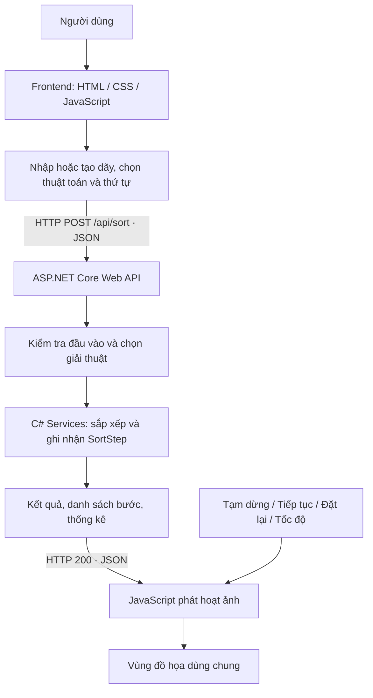

<div align="center">
  <h1>📊 SORTING ALGORITHM VISUALIZER</h1>
  <h3>MÔ PHỎNG HOẠT ĐỘNG CỦA MỘT SỐ GIẢI THUẬT SẮP XẾP TRÊN MÀN HÌNH ĐỒ HỌA</h3>
  <p><strong>Đồ án cơ sở ngành · Khoa Công nghệ Thông tin · Trường Đại học Nha Trang</strong></p>
  <p>
    
    
    
  </p>
  <p>
    
    
    
    
  </p>
  <p>
    
    
    
    
  </p>
  <p><em>Học giải thuật bằng cách <strong>nhìn thấy từng bước xử lý</strong> — từ so sánh, hoán đổi đến chia, trộn và phân hoạch.</em></p>
</div>

---

## 🌟 Giới thiệu

Trong học phần **Cấu trúc dữ liệu và Giải thuật**, việc chỉ quan sát giả mã hoặc mã nguồn có thể khiến người học khó hình dung quá trình sắp xếp. Đề tài hướng đến xây dựng một **website mô phỏng trực quan sáu giải thuật sắp xếp thông dụng**, hỗ trợ sinh viên học tập và giảng viên minh họa trên lớp.

Hệ thống sử dụng **C# và ASP.NET Core Web API** để xử lý thuật toán ở backend. Frontend được xây dựng bằng **HTML, CSS và JavaScript**, nhận dữ liệu JSON từ API và tái hiện từng bước dưới dạng hoạt ảnh trên trình duyệt.

> **Ý tưởng giao diện:** Sáu lựa chọn thuật toán nằm ở phía trên, kết hợp bộ chọn thứ tự tăng dần/giảm dần và khu vực chuẩn bị dữ liệu. Phía dưới là một vùng đồ họa dùng chung, chỉ hiển thị thuật toán đang được chọn.

---

## 🎯 Mục tiêu đồ án

- Nghiên cứu nguyên lý, độ phức tạp thời gian, bộ nhớ phụ và tính ổn định của sáu giải thuật.
- Cài đặt sáu giải thuật bằng C#, hỗ trợ sắp xếp mảng số nguyên theo thứ tự **tăng dần (ASC)** hoặc **giảm dần (DESC)**.
- Xây dựng ASP.NET Core Web API để cung cấp kết quả, danh sách các bước và thống kê thao tác dưới dạng JSON.
- Cho phép người dùng nhập dãy số thủ công hoặc tạo dãy số ngẫu nhiên.
- Xây dựng giao diện mô phỏng có khả năng bắt đầu, tạm dừng, tiếp tục, đặt lại và điều chỉnh tốc độ.
- Kiểm thử tính đúng đắn của kết quả và sự nhất quán giữa các bước thuật toán với hoạt ảnh.

---

## 🧠 Sáu giải thuật được nghiên cứu

| Giải thuật         | Ý tưởng chính                                                    |  Tốt nhất   | Trung bình |  Xấu nhất  | Bộ nhớ phụ | Ổn định |
| :----------------- | :--------------------------------------------------------------- | :---------: | :--------: | :--------: | :--------: | :-----: |
| **Selection Sort** | Chọn phần tử nhỏ nhất hoặc lớn nhất đưa về đầu vùng chưa sắp xếp |    O(n²)    |   O(n²)    |   O(n²)    |    O(1)    |  Không  |
| **Bubble Sort**    | So sánh và đổi chỗ các phần tử kề nhau khi sai thứ tự            |    O(n)¹    |   O(n²)    |   O(n²)    |    O(1)    |   Có    |
| **Insertion Sort** | Chèn phần tử vào đúng vị trí trong đoạn đã có thứ tự             |    O(n)     |   O(n²)    |   O(n²)    |    O(1)    |   Có    |
| **Merge Sort**     | Chia dãy thành các phần nhỏ rồi trộn theo thứ tự yêu cầu         | O(n log n)  | O(n log n) | O(n log n) |    O(n)    |   Có    |
| **Quick Sort**     | Chọn pivot, phân hoạch và xử lý các dãy con                      | O(n log n)  | O(n log n) |   O(n²)    | O(log n)²  |  Không  |
| **Heap Sort**      | Xây dựng heap, đưa phần tử ở gốc về cuối vùng chưa sắp xếp       | O(n log n)³ | O(n log n) | O(n log n) |   O(1)⁴    |  Không  |

¹ Bubble Sort có kiểm tra dừng sớm.  
² Bộ nhớ ngăn xếp đệ quy của Quick Sort trong trường hợp trung bình; trường hợp xấu nhất có thể là O(n).  
³ Heap Sort có giới hạn trên O(n log n); số thao tác thực tế có thể thấp hơn trên một số đầu vào, tùy cách cài đặt.  
⁴ Với thao tác hiệu chỉnh heap bằng vòng lặp.

> Bảng thể hiện độ phức tạp của các thuật toán cơ bản, chưa tính chi phí ghi và lưu các bản sao trạng thái phục vụ mô phỏng. Tính ổn định được xét với các cách cài đặt thông dụng tương ứng.

<details>
<summary><strong>🔎 Xem quy tắc sắp xếp theo hai chiều và thao tác mô phỏng</strong></summary>

| Thuật toán     | Tăng dần                                      | Giảm dần                                      | Trạng thái cần làm nổi bật                     |
| :------------- | :-------------------------------------------- | :-------------------------------------------- | :--------------------------------------------- |
| Selection Sort | Chọn phần tử nhỏ nhất                         | Chọn phần tử lớn nhất                         | Ứng viên, so sánh, hoán đổi, vị trí hoàn thành |
| Bubble Sort    | Đổi chỗ khi phần tử trước lớn hơn phần tử sau | Đổi chỗ khi phần tử trước nhỏ hơn phần tử sau | Cặp phần tử kề nhau, đoạn cuối đã hoàn thành   |
| Insertion Sort | Dịch các phần tử lớn hơn key sang phải        | Dịch các phần tử nhỏ hơn key sang phải        | Key, dịch chuyển, vị trí chèn                  |
| Merge Sort     | Ưu tiên giá trị nhỏ hơn khi trộn              | Ưu tiên giá trị lớn hơn khi trộn              | Các dãy con, vùng trộn, thao tác ghi           |
| Quick Sort     | Phân hoạch theo thứ tự tăng dần               | Đảo chiều quy tắc so sánh khi phân hoạch      | Pivot, vùng phân hoạch, hoán đổi               |
| Heap Sort      | Max-heap                                      | Min-heap                                      | Gốc heap, hiệu chỉnh heap, vùng đã hoàn thành  |

</details>

---

## ✨ Các chức năng dự kiến

| Nhóm chức năng          | Mô tả                                                                             |
| :---------------------- | :-------------------------------------------------------------------------------- |
| 🔢 **Nhập dữ liệu**     | Nhập thủ công dãy số nguyên.                                                      |
| 🎲 **Tạo ngẫu nhiên**   | Chọn số lượng phần tử và khoảng giá trị, sinh dãy ngay trên trình duyệt.          |
| 🧩 **Chọn thuật toán**  | Lựa chọn một trong sáu thuật toán trên cùng giao diện.                            |
| ↕️ **Chọn thứ tự**      | Chọn tăng dần hoặc giảm dần, mặc định tăng dần.                                   |
| ▶️ **Điều khiển**       | Bắt đầu, tạm dừng, tiếp tục và đặt lại tiến trình mô phỏng.                       |
| 🎚️ **Tốc độ**           | Điều chỉnh độ trễ giữa các bước hiển thị mà không cần chạy lại thuật toán.        |
| 🎨 **Trực quan hóa**    | Biểu diễn các phần tử bằng cột, làm nổi bật các thao tác và vị trí đã hoàn thành. |
| 📈 **Thống kê**         | Hiển thị kết quả, số lần so sánh, hoán đổi và di chuyển/ghi phần tử.              |
| ⚠️ **Kiểm tra dữ liệu** | Thông báo dữ liệu không hợp lệ và lỗi kết nối API.                                |

Dữ liệu ngẫu nhiên được dự kiến tạo bằng JavaScript (`Math.random()`), không cần một API riêng. Cả dữ liệu nhập thủ công và dữ liệu ngẫu nhiên đều được gửi dưới dạng mảng số nguyên cho cùng một API sắp xếp.

---

## 🏗️ Kiến trúc hệ thống



Hệ thống được chia thành ba thành phần chính:

| Thành phần   | Vai trò                                                                  |
| :----------- | :----------------------------------------------------------------------- |
| **Frontend** | Chuẩn bị dữ liệu, tiếp nhận lựa chọn, gửi yêu cầu và hiển thị hoạt ảnh.  |
| **Web API**  | Xác thực dữ liệu đầu vào, gọi giải thuật C# và đóng gói phản hồi JSON.   |
| **Services** | Thực hiện thuật toán, lưu trạng thái mảng và các thao tác tại từng bước. |

Frontend dự kiến được phục vụ từ `wwwroot` của cùng ứng dụng ASP.NET Core. Trình duyệt nhận toàn bộ danh sách bước sau mỗi yêu cầu sắp xếp, sau đó điều khiển hoạt ảnh tại chỗ; không gọi API cho từng khung hình.

**Cơ sở dữ liệu:** Không sử dụng hệ quản trị cơ sở dữ liệu. Dữ liệu chỉ tồn tại trong bộ nhớ khi xử lý yêu cầu hoặc trong phiên mô phỏng trên trình duyệt.

---

## 📁 Cấu trúc mã nguồn

Cấu trúc dưới đây là thiết kế dự kiến của project `SortingVisualizer` khi hoàn thiện:

```text
SortingVisualizer/
├── Controllers/
│   └── SortController.cs
├── Models/
│   ├── SortRequest.cs
│   ├── SortResponse.cs
│   └── SortStep.cs
├── Services/
│   ├── SelectionSort.cs
│   ├── BubbleSort.cs
│   ├── InsertionSort.cs
│   ├── MergeSort.cs
│   ├── QuickSort.cs
│   └── HeapSort.cs
├── wwwroot/
│   ├── index.html
│   ├── css/
│   │   └── style.css
│   └── js/
│       └── script.js
├── Properties/
│   └── launchSettings.json
├── Program.cs
├── appsettings.json
├── SortingVisualizer.http
└── SortingVisualizer.csproj
```

- `Models`: Định nghĩa yêu cầu, phản hồi và dữ liệu mỗi bước mô phỏng; `SortStatistics` được đặt trong `SortResponse.cs` theo thiết kế hiện tại.
- `Services`: Chứa các thuật toán sắp xếp viết bằng C#.
- `Controllers`: Tiếp nhận và xử lý yêu cầu HTTP.
- `wwwroot`: Chứa các tệp HTML, CSS và JavaScript.
- `SortingVisualizer.http`: Dùng để gửi yêu cầu kiểm thử API ngay trong Visual Studio.

Các tệp chưa được triển khai sẽ được bổ sung trong quá trình phát triển.

---

## 🔌 Thiết kế Web API

**Endpoint:** `POST /api/sort`

**Content-Type:** `application/json`

### Yêu cầu (Request)

```json
{
  "algorithm": "selection",
  "values": [5, 2, 4, 1],
  "order": "desc"
}
```

| Trường      | Ý nghĩa                                                                                                |
| :---------- | :----------------------------------------------------------------------------------------------------- |
| `algorithm` | Mã thuật toán: `selection`, `bubble`, `insertion`, `merge`, `quick`, `heap` (theo phạm vi hoàn thiện). |
| `values`    | Mảng số nguyên cần sắp xếp.                                                                            |
| `order`     | `asc` hoặc `desc`; mặc định `asc`.                                                                     |

### Phản hồi (Response)

Ví dụ minh họa một phản hồi rút gọn của Selection Sort với yêu cầu trên:

```json
{
  "algorithm": "selection",
  "order": "desc",
  "original": [5, 2, 4, 1],
  "sorted": [5, 4, 2, 1],
  "statistics": {
    "comparisons": 6,
    "swaps": 1,
    "moves": 0
  }
}
```

Phản hồi đầy đủ còn có trường `steps` chứa toàn bộ danh sách bước. Mỗi bước có cấu trúc cơ bản sau (ví dụ ở lượt thứ hai):

```json
{
  "type": "compare",
  "array": [5, 2, 4, 1],
  "indices": [1, 2],
  "sortedIndices": [0],
  "description": "So sánh 2 và 4"
}
```

| Trường trong `SortStep` | Ý nghĩa                                                             |
| :---------------------- | :------------------------------------------------------------------ |
| `type`                  | Loại thao tác, ví dụ `compare`, `select`, `swap`, `sorted`, `done`. |
| `array`                 | Bản sao trạng thái mảng tại bước hiện tại.                          |
| `indices`               | Chỉ số các phần tử đang được xử lý (bắt đầu từ 0).                  |
| `sortedIndices`         | Chỉ số các phần tử đã được xác định ở đúng vị trí cuối cùng.        |
| `description`           | Mô tả thao tác giúp người học theo dõi.                             |

Các trường đặc thù như pivot, phạm vi trộn và kích thước heap có thể được bổ sung khi triển khai các thuật toán tương ứng.

Theo thiết kế hiện tại, API kiểm tra tên thuật toán, chiều sắp xếp và mảng đầu vào, giới hạn tối đa **50 phần tử** cho mỗi yêu cầu để kiểm soát kích thước dữ liệu mô phỏng. Giới hạn này có thể thay đổi khi kiểm thử. API trả về HTTP 400 cho yêu cầu không hợp lệ.

---

## 🛠️ Công nghệ sử dụng

| Công nghệ / Công cụ      | Vai trò                                                            |
| :----------------------- | :----------------------------------------------------------------- |
| **C#**                   | Cài đặt thuật toán và ghi nhận từng bước xử lý.                    |
| **.NET 10 (LTS)**        | Nền tảng biên dịch và thực thi backend.                            |
| **ASP.NET Core Web API** | Xử lý HTTP, xác thực yêu cầu và cung cấp phản hồi JSON.            |
| **HTML**                 | Xây dựng cấu trúc giao diện website.                               |
| **CSS**                  | Thiết kế bố cục, màu sắc và hiệu ứng chuyển trạng thái.            |
| **JavaScript**           | Tạo dãy ngẫu nhiên, gọi API bằng Fetch API và điều khiển hoạt ảnh. |
| **JSON / HTTP**          | Trao đổi dữ liệu giữa frontend và backend.                         |
| **OpenAPI**              | Mô tả các endpoint của Web API.                                    |
| **Visual Studio**        | Lập trình, biên dịch, kiểm thử và gỡ lỗi.                          |
| **Git / GitHub**         | Quản lý phiên bản và lưu trữ mã nguồn.                             |

---

## 🚀 Hướng dẫn mở và chạy dự án

### Yêu cầu môi trường

- Visual Studio hỗ trợ .NET 10, đã cài workload **ASP.NET and web development**.
- **.NET 10 SDK**.
- Trình duyệt web hiện đại như Chrome, Edge hoặc Firefox.
- Git hoặc GitHub Desktop nếu muốn clone repository và quản lý phiên bản.

### Cách 1: Chạy bằng Visual Studio

1. Clone repository bằng GitHub Desktop hoặc tải bằng **Code → Download ZIP** và giải nén.
2. Mở file solution (`.sln` hoặc `.slnx`) bằng Visual Studio; nếu chỉ có `.csproj`, mở project tương ứng.
3. Đợi khôi phục các gói NuGet, chọn **Build → Build Solution**.
4. Chọn launch profile `https` và nhấn **F5** hoặc **Ctrl + F5**.
5. Xem địa chỉ máy chủ tại dòng `Now listening on:` trong cửa sổ Terminal.
6. Khi frontend đã được triển khai và cấu hình phục vụ tệp tĩnh, mở địa chỉ đó trên trình duyệt.

### Cách 2: Chạy bằng .NET CLI

Mở Terminal tại thư mục chứa `SortingVisualizer.csproj`, sau đó chạy:

```bash
dotnet restore
dotnet build
dotnet run
```

Sử dụng địa chỉ được in ra trên Terminal. Cổng có thể khác nhau tùy cấu hình `launchSettings.json`.

### Kiểm thử API trong Visual Studio

Khi `SortController.cs` đã được hoàn thiện và ứng dụng đang chạy, mở file `SortingVisualizer.http`, điều chỉnh địa chỉ máy chủ cho đúng với Terminal, rồi gửi yêu cầu:

```http
@SortingVisualizer_HostAddress = https://localhost:7155

POST {{SortingVisualizer_HostAddress}}/api/sort
Content-Type: application/json

{
  "algorithm": "selection",
  "values": [5, 2, 4, 1],
  "order": "asc"
}
```

Kết quả mong đợi: HTTP 200, mảng `sorted` là `[1, 2, 4, 5]`. Đổi `order` thành `desc` để kiểm tra kết quả `[5, 4, 2, 1]`.

> Địa chỉ `https://localhost:7155` là ví dụ theo cấu hình phát triển đã sử dụng; thay bằng địa chỉ thực tế khi chạy. Nếu HTTPS báo lỗi chứng chỉ trên máy phát triển, có thể dùng `dotnet dev-certs https --trust` để tin cậy chứng chỉ phát triển.

> Dự án hiện đang phát triển backend. Nếu chưa có frontend hoặc chưa cấu hình phục vụ `wwwroot`, truy cập đường dẫn `/` có thể trả về 404 dù máy chủ API vẫn hoạt động. GitHub chỉ lưu mã nguồn; GitHub Pages không trực tiếp chạy backend ASP.NET Core.

---

## 🧪 Kế hoạch kiểm thử

| Trường hợp                        | Tiêu chí kiểm tra                                                                       |
| :-------------------------------- | :-------------------------------------------------------------------------------------- |
| Dãy ngẫu nhiên                    | Sắp xếp đúng theo cả hai chiều.                                                         |
| Dãy tăng dần / giảm dần           | Xử lý đúng khi đầu vào đã có thứ tự hoặc ngược thứ tự yêu cầu.                          |
| Giá trị trùng lặp                 | Bảo toàn số lượng và giá trị của các phần tử.                                           |
| Số âm và số 0                     | So sánh và sắp xếp đúng các giá trị số nguyên.                                          |
| Mảng rỗng / một phần tử           | Không phát sinh lỗi; không thực hiện thao tác sắp xếp không cần thiết.                  |
| Mảng null / dữ liệu sai định dạng | API từ chối dữ liệu không hợp lệ.                                                       |
| Thuật toán / chiều không hợp lệ   | Trả về lỗi phù hợp.                                                                     |
| Mô phỏng và điều khiển            | Các bước, màu sắc, thống kê, tạm dừng, tiếp tục, đặt lại và tốc độ hoạt động nhất quán. |

Kiểm thử từng thuật toán theo cả `asc` và `desc`, đối chiếu mảng kết quả, bảo toàn dữ liệu đầu vào và kiểm tra các bước hiển thị có phản ánh đúng thao tác thực tế hay không.

Số lần so sánh và hoán đổi được thống kê riêng với số lần di chuyển/ghi. Thời gian phát hoạt ảnh không được xem là thời gian thực thi của thuật toán.

---

## 📌 Tiến độ phát triển

Cập nhật theo phần mã nguồn và tiến độ lập trình đã trao đổi; chưa xác nhận kết quả kiểm thử tích hợp trên repository.

- [x] Khởi tạo dự án ASP.NET Core Web API trên .NET 10.
- [x] Xây dựng lớp `SortStep` lưu trạng thái mô phỏng.
- [x] Viết Selection Sort hỗ trợ tăng dần, giảm dần và ghi nhận các bước.
- [ ] Hoàn thiện và kiểm thử `SortRequest`, `SortResponse`, `SortController` và endpoint `/api/sort`.
- [ ] Xây dựng giao diện và hoạt ảnh Selection Sort.
- [ ] Tích hợp nhập thủ công, tạo ngẫu nhiên và các nút điều khiển.
- [ ] Cài đặt Bubble Sort, Insertion Sort, Merge Sort, Quick Sort và Heap Sort.
- [ ] Kiểm thử toàn bộ website và hoàn thiện báo cáo đồ án.

---

## 📷 Giao diện chương trình

_Ảnh chụp màn hình và GIF mô phỏng sẽ được bổ sung khi có phiên bản website chạy thực tế._

---

## 📚 Tài liệu tham khảo tiêu biểu

- [MIT OpenCourseWare — Introduction to Algorithms (6.006)](https://ocw.mit.edu/courses/6-006-introduction-to-algorithms-fall-2011/pages/lecture-notes/)
- [Princeton — Algorithms, 4th Edition](https://algs4.cs.princeton.edu/home/)
- [Microsoft Learn — C#](https://learn.microsoft.com/en-us/dotnet/csharp/tour-of-csharp)
- [Microsoft Learn — ASP.NET Core Web API](https://learn.microsoft.com/en-us/aspnet/core/web-api/)
- [Microsoft Learn — Static files in ASP.NET Core](https://learn.microsoft.com/en-us/aspnet/core/fundamentals/static-files)
- [MDN Web Docs — Using the Fetch API](https://developer.mozilla.org/en-US/docs/Web/API/Fetch_API/Using_Fetch)

---

## 👨‍🎓 Thông tin đồ án

| Thông tin                | Chi tiết                                                              |
| :----------------------- | :-------------------------------------------------------------------- |
| **Đề tài**               | Mô phỏng hoạt động của một số giải thuật sắp xếp trên màn hình đồ họa |
| **Sinh viên thực hiện**  | **Phan Lập Công**                                                     |
| **Mã số sinh viên**      | 66130353                                                              |
| **Lớp**                  | 66.CNPM                                                               |
| **Giảng viên hướng dẫn** | TS. Nguyễn Đình Hưng                                                  |
| **Đơn vị**               | Khoa Công nghệ Thông tin – Trường Đại học Nha Trang                   |
| **Thời điểm báo cáo**    | 2026                                                                  |

---

<div align="center">
  <p><strong>📘 ĐỒ ÁN CƠ SỞ NGÀNH · NHA TRANG UNIVERSITY</strong></p>
  <p><em>Trực quan hóa thuật toán — giúp việc học trở nên dễ hiểu hơn qua từng bước xử lý.</em></p>
</div>
